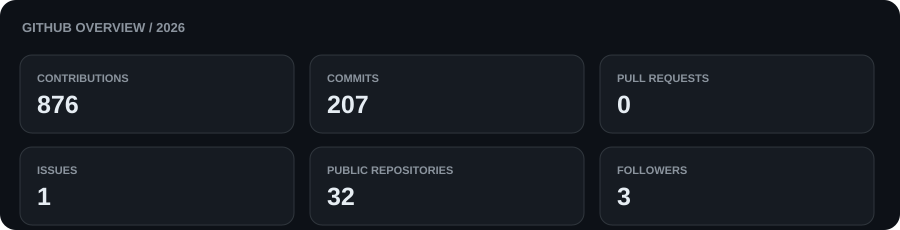
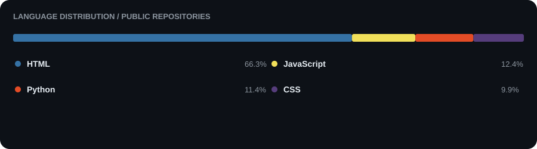
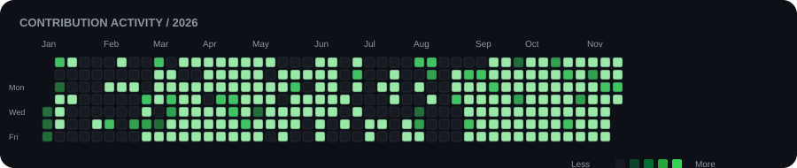

<p align="center">
  
</p>

<h1 align="center">Orlando Henry</h1>

<p align="center">
  <strong>Python &amp; Django Developer · Backend Engineering · Founder, ORLANTECH INNOVATIONS</strong>
</p>

<p align="center">
  Building practical software and turning ideas into useful digital products.
</p>

<p align="center">
  <a href="https://orland0henry.github.io/orlanweb/">Portfolio</a> ·
  <a href="https://github.com/ORLAND0HENRY?tab=repositories">Repositories</a> ·
  <a href="https://ke.linkedin.com/in/orlando-henry-842972360">LinkedIn</a>
</p>

<p align="center">
  
  
  
</p>

---

## About

I'm Orlando Henry, a developer, technology enthusiast, and founder of **ORLANTECH INNOVATIONS**. I build web applications and digital solutions with Python and Django, and I'm especially interested in the backend systems that make software reliable and useful.

I enjoy taking a practical problem from idea to implementation: understanding the need, shaping a solution, and working through the engineering details. Beyond web development, I'm exploring cybersecurity, artificial intelligence, and automation. I believe strong engineering starts with understanding the fundamentals—not just learning which tools to use.

## What I Do

| Area | What I work on |
| --- | --- |
| **Backend development** | Django applications, business logic, authentication, data management, and application workflows. |
| **Web development** | Responsive web experiences using HTML, CSS, Tailwind CSS, and JavaScript. |
| **Digital solutions** | Turning practical problems into useful applications for businesses, institutions, and communities. |
| **Security & automation** | Learning application security and cybersecurity fundamentals, along with scripting and workflow automation. |

## Technology

<p align="center">
  
</p>

**Tools I use**

- Python and Django
- HTML, CSS, Tailwind CSS, and JavaScript
- Git and GitHub

**Currently developing my skills in**

- Backend engineering and application architecture
- Relational databases and data modelling
- API development and integrations
- Testing, debugging, and secure coding
- Cybersecurity and automation

I focus on building a solid understanding of the technologies I use and applying that knowledge through real projects.

## Selected Projects

### Pendo School Management

A school management application exploring how software can simplify educational administration and institutional workflows.

**Technologies:** Python · Django · HTML · Tailwind CSS  
**Focus:** Application logic, authentication, data management, and role-based workflows.

### SDA Kangemi Ambassadors

A live website for a church youth ministry and choir, offering a central digital home for activities, announcements, events, and media.

**Technologies:** Python · Django · HTML · CSS · JavaScript  
**Focus:** Responsive design, content management, media handling, and progressive web application features.

[Visit the live website](https://kangemiambassadors.pythonanywhere.com)

### Orlanweb Portfolio

My personal portfolio, showcasing my development work, projects, and professional journey.

**Focus:** Web development · Personal branding · Digital presentation

[Explore the portfolio](https://orland0henry.github.io/orlanweb/)

<p align="center">
  <a href="https://github.com/ORLAND0HENRY?tab=repositories">
    
  </a>
</p>

## ORLANTECH INNOVATIONS

<p align="center">
  <strong>Technology. Creativity. Innovation.</strong>
</p>

**ORLANTECH INNOVATIONS** is a technology venture founded on a simple idea: technology should solve meaningful problems. Its direction is centred on practical digital products, software solutions, and opportunities across emerging technologies.

The ambition goes beyond writing code: it's about understanding people, identifying opportunities, and creating technology that delivers real value.

> Turning ideas into useful digital experiences.

## GitHub Analytics

<p align="center">
  
</p>

<p align="center">
  
</p>

<p align="center">
  
</p>

### Contribution Activity

<p align="center">
  
</p>

<p align="center">
  <sub>These cards are automatically updated through GitHub Actions.</sub>
</p>

## Engineering Philosophy

```text
       UNDERSTAND
           |
           v
         DESIGN
           |
           v
          BUILD
           |
           v
       TEST & DEBUG
           |
           v
         REFINE
           |
           v
         REPEAT
```

- **Fundamentals over shortcuts:** understand how things work beneath the surface.
- **Practical experience over theory alone:** apply what I learn through real projects.
- **Problem-solving over trends:** choose tools based on the problem.
- **Continuous improvement over perfection:** learn, adapt, and build better solutions.

I'm still growing as an engineer, and that's a process I enjoy.

## Let's Connect

I'm always glad to connect with developers, founders, entrepreneurs, and others exploring meaningful ideas in technology. Feel free to reach out to discuss software engineering, exchange ideas, or explore a potential collaboration.

<p align="center">
  <a href="https://orland0henry.github.io/orlanweb/">
    
  </a>
  <a href="https://github.com/ORLAND0HENRY">
    
  </a>
  <a href="https://ke.linkedin.com/in/orlando-henry-842972360">
    
  </a>
</p>

---

<p align="center">
  <strong>ORLANTECH INNOVATIONS</strong>
  <br>
  <sub>Where technology meets creativity and purpose.</sub>
  <br><br>
  <sub>Designed and built by Orlando Henry.</sub>
</p>
