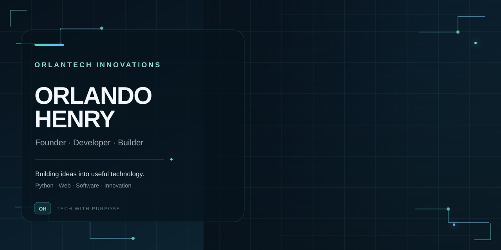

 
<p align="center">
  
</p>

<h1 align="center">Orlando Henry</h1>

<p align="center">
  <strong>Backend Developer · Python & Django · Founder, ORLANTECH INNOVATIONS</strong>
</p>

<p align="center">
  Building practical digital products through code, curiosity, and continuous improvement.
</p>

<p align="center">
  <a href="https://orland0henry.github.io/orlanweb/">Portfolio</a> ·
  <a href="https://github.com/ORLAND0HENRY?tab=repositories">Projects</a> ·
  <a href="https://www.linkedin.com/">LinkedIn</a>
</p>

<p align="center">
  
  
  
</p>

---

## `01` — About Me

I'm Orlando Henry, a developer, technology enthusiast, and founder of **ORLANTECH INNOVATIONS**.

My focus is building useful digital solutions that address real problems. I work primarily with Python and Django, developing web applications and strengthening my understanding of the engineering principles behind them.

I enjoy the entire process: understanding a problem, designing a solution, writing the code, debugging what breaks, and refining the result until it works better.

I'm particularly interested in backend engineering, cybersecurity, automation, and the broader possibilities of artificial intelligence.

**My approach:** Understand the fundamentals. Build real things. Learn from the process & Keep improving.

## `02` — What I Build

<table>
  <tr>
    <td width="50%">
      <h3>01. Web Applications</h3>
      Developing functional web experiences with Django, Python, HTML, and Tailwind CSS.
    </td>
    <td width="50%">
      <h3>02. Backend Systems</h3>
      Exploring application logic, authentication, data handling, database design, and maintainable code.
    </td>
  </tr>
  <tr>
    <td width="50%">
      <h3>03. Digital Products</h3>
      Turning ideas into usable tools for businesses, organizations, and communities.
    </td>
    <td width="50%">
      <h3>04. Security & Automation</h3>
      Exploring cybersecurity concepts, scripting, and ways to make technology more efficient and reliable.
    </td>
  </tr>
</table>

## `03` — Technology Stack

<p align="center">
  
</p>

**Core development**
- Python and Django
- HTML, CSS, and Tailwind CSS
- Git and GitHub
- Django templates, forms, models, authentication, and admin workflows

**Currently developing my skills in**
- Deeper backend engineering fundamentals
- Relational databases and data modelling
- API development and application integration
- Software architecture, testing, and secure coding
- Cybersecurity and automation

I believe in learning technology by applying it to real projects, not just collecting tools.

## `04` — Selected Work

### Pendo School Management

A school management project focused on applying web development to practical educational administration needs.

**Focus:** Django · Application logic · Data management

### SDA Kangemi Ambassadors

A live ministry website built to support a church youth ministry and choir through its digital presence.

**Focus:** Django · Responsive frontend · Content management

[Visit the website](https://kangemiambassadors.pythonanywhere.com)

### Orlanweb Portfolio

My personal portfolio and professional presence, bringing together my development journey and work.

**Focus:** Web development · Personal branding

[Visit my portfolio](https://orland0henry.github.io/orlanweb/)

<p align="center">
  <a href="https://github.com/ORLAND0HENRY?tab=repositories">
    
  </a>
</p>

## `05` — ORLANTECH INNOVATIONS

<p align="center">
  <strong>Technology. Creativity. Innovation.</strong>
</p>

ORLANTECH INNOVATIONS is my technology venture, driven by the belief that useful technology begins with understanding real problems.

The vision is to create practical digital solutions, explore emerging technologies, and turn promising ideas into products people can use.

It's more than a name attached to my projects. It's the direction I'm working toward: building solutions, developing technical depth, and growing through the process of creating.

> **Turning ideas into useful digital experiences.**

## `06` — GitHub Activity

<p align="center">
  
  
</p>

<p align="center">
  
</p>

## `07` — The Engineering Mindset

```text
UNDERSTAND THE PROBLEM
          |
          v
DESIGN THE SOLUTION
          |
          v
BUILD & TEST
          |
          v
LEARN FROM THE RESULT
          |
          v
IMPROVE & REPEAT
```

I'm building my skills one project at a time, with an emphasis on understanding how things work beneath the surface.

I value curiosity over assumptions, fundamentals over shortcuts, and consistent progress over the illusion of knowing everything.

## `08` — Let's Connect

I'm open to connecting with developers, founders, technology enthusiasts, and people working on meaningful digital products.

Whether it's exchanging ideas, collaborating on a project, or discussing software development and cybersecurity, I'd be glad to connect.

<p align="center">
  <a href="https://orland0henry.github.io/orlanweb/">
    
  </a>
  <a href="https://github.com/ORLAND0HENRY">
    
  </a>
  <a href="https://ke.linkedin.com/in/orlando-henry-842972360">
    
  </a>
</p>

---

<p align="center">
  <strong>ORLANTECH INNOVATIONS</strong>
  <br>
  <sub>Where tech meets creativity and passion.</sub>
  <br><br>
  <sub>Designed and built by Orlando Henry.</sub>
</p>
