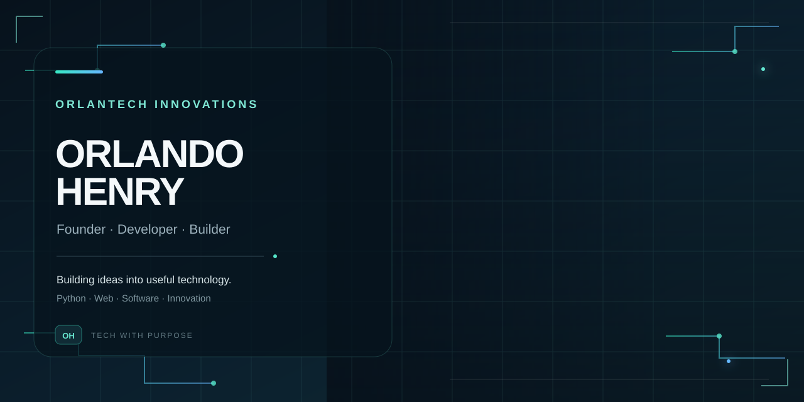
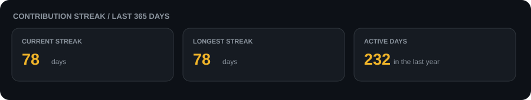

<p align="center">
  
</p>

<h1 align="center">Orlando Henry</h1>

<p align="center">
  <strong>Python &amp; Django Developer | Backend Engineer | Founder @ ORLANTECH INNOVATIONS</strong>
</p>

<p align="center">
  I design and build reliable digital systems, turning complex problems into practical software products.
</p>

<p align="center">
  <a href="https://orland0henry.github.io/orlanweb/">Portfolio</a> ·
  <a href="https://github.com/ORLAND0HENRY?tab=repositories">Repositories</a> ·
  <a href="https://ke.linkedin.com/in/orlando-henry-842972360">LinkedIn</a>
</p>

<p align="center">
  
  
  
</p>

---

## About

I’m Orlando Henry, a software engineer and founder of **ORLANTECH INNOVATIONS**. My work sits at the intersection of product thinking, systems design, and practical development.

I build web applications and digital solutions with Python and Django, with a special interest in backend systems that are dependable, scalable, and useful in the real world. I enjoy taking ideas from concept to execution—understanding the problem, shaping the solution, and building the technical foundation that makes it work.

Beyond software development, I’m interested in cybersecurity, AI, automation, and modern engineering practices. I value strong fundamentals, disciplined thinking, and creating technology that solves meaningful problems.

## Core Expertise

<table>
  <tr>
    <td width="50%" valign="top">
      <h3>Backend Engineering</h3>
      Building Django-powered applications, business logic, authentication, workflow automation, and data-driven systems.
    </td>
    <td width="50%" valign="top">
      <h3>Product-Focused Development</h3>
      Translating real-world problems into practical, user-centred digital products and business solutions.
    </td>
  </tr>
  <tr>
    <td width="50%" valign="top">
      <h3>Web Application Design</h3>
      Creating responsive web experiences with HTML, CSS, Tailwind CSS, and JavaScript.
    </td>
    <td width="50%" valign="top">
      <h3>Security & Automation</h3>
      Exploring secure coding practices, application security, scripting, and workflow automation.
    </td>
  </tr>
</table>

## Technology

<p align="center">
  
</p>

**Working with**

- Python
- Django
- HTML5, CSS3, and Tailwind CSS
- JavaScript
- Git and GitHub

**Deepening my knowledge**

- Backend architecture and system design
- Relational databases and data modelling
- API development and integrations
- Testing, debugging, and secure coding
- Cybersecurity and automation

I focus on building a strong technical foundation and applying that knowledge through real projects that solve practical problems.

## Selected Projects

### Pendo School Management

A school management application focused on improving administrative efficiency and institutional workflows.

**Technologies:** Python · Django · HTML · Tailwind CSS  
**Engineering focus:** Authentication, data handling, role-based access, and business workflow logic.

---

### SDA Kangemi Ambassadors

A digital platform for a church youth ministry and choir, designed to centralise activities, announcements, events, and media.

**Technologies:** Python · Django · HTML · CSS · JavaScript  
**Engineering focus:** Responsive design, content management, media presentation, and user engagement.

[Visit live website](https://kangemiambassadors.pythonanywhere.com)

---

### Orlanweb Portfolio

A personal portfolio that brings together my work, ideas, and professional journey in a polished digital presentation.

**Focus:** Web design · Personal branding · Digital storytelling

[Explore portfolio](https://orland0henry.github.io/orlanweb/)

<p align="center">
  <a href="https://github.com/ORLAND0HENRY?tab=repositories">
    
  </a>
</p>

## ORLANTECH INNOVATIONS

<p align="center">
  <strong>Technology. Creativity. Innovation.</strong>
</p>

**ORLANTECH INNOVATIONS** exists to turn practical ideas into useful technology. The mission is to build meaningful digital solutions, support modern business needs, and explore opportunities across emerging technologies.

The goal is not only to write code, but to understand the problem, design thoughtful systems, and create value through technology that works.

> Turning ideas into useful digital experiences.

## GitHub Analytics

<p align="center">
  
</p>

<p align="center">
  
</p>

<p align="center">
  
</p>

### Contribution Activity

<p align="center">
  
</p>

<p align="center">
  <sub>Generated and updated automatically through GitHub Actions.</sub>
</p>

## Engineering Philosophy

```text
       UNDERSTAND
           |
           v
         DESIGN
           |
           v
          BUILD
           |
           v
       TEST & DEBUG
           |
           v
         REFINE
           |
           v
         REPEAT
```

I value:

- **Fundamentals over shortcuts.** Good engineering starts with understanding how systems work.
- **Practical experience over theory alone.** Real projects teach better than passive learning.
- **Problem-solving over hype.** Tools should serve the goal, not the other way around.
- **Continuous improvement over perfection.** The best work is built iteratively and refined over time.

I’m still growing as an engineer, and that process is part of what I enjoy most.

## Let’s Connect

I’m always interested in connecting with developers, founders, entrepreneurs, and people exploring meaningful ideas in technology. Whether it’s about software engineering, product thinking, or collaboration, I’d be glad to connect.

<p align="center">
  <a href="https://orland0henry.github.io/orlanweb/">
    
  </a>
  <a href="https://github.com/ORLAND0HENRY">
    
  </a>
  <a href="https://ke.linkedin.com/in/orlando-henry-842972360">
    
  </a>
</p>

---

<p align="center">
  <strong>ORLANTECH INNOVATIONS</strong>
  <br>
  <sub>Where technology meets creativity and purpose.</sub>
  <br><br>
  <sub>Designed and built by Orlando Henry.</sub>
</p>
