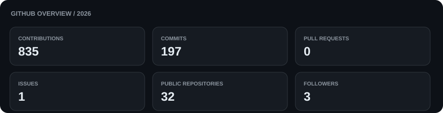
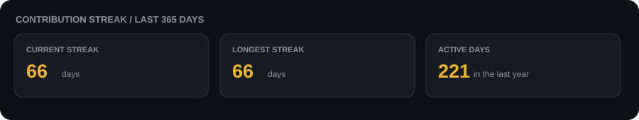
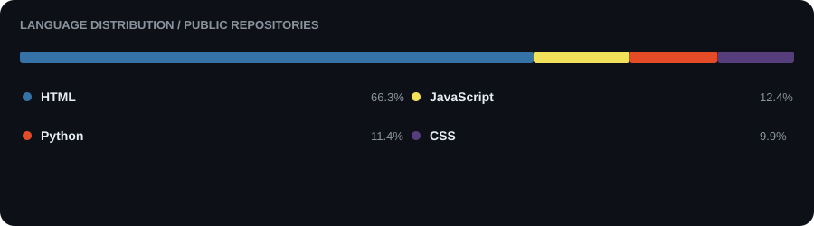
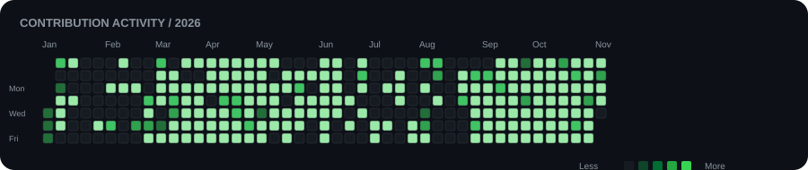

<p align="center">
  
</p>

<h1 align="center">Orlando Henry</h1>

<p align="center">
  <strong>Python & Django Developer | Backend Engineering | Founder @ ORLANTECH INNOVATIONS</strong>
</p>

<p align="center">
  Building practical software, exploring technology, and turning ideas into useful digital products.
</p>

<p align="center">
  <a href="https://orland0henry.github.io/orlanweb/">Portfolio</a> ·
  <a href="https://github.com/ORLAND0HENRY?tab=repositories">Repositories</a> ·
  <a href="https://ke.linkedin.com/in/orlando-henry-842972360">LinkedIn</a>
</p>

<p align="center">
  
  
  
</p>

---

## 01 / About

I'm Orlando Henry, a developer, technology enthusiast, and founder of **ORLANTECH INNOVATIONS**.

I build web applications and digital solutions using Python and Django, with a particular interest in the backend systems that make software work.

My development journey is driven by practical problem-solving. I enjoy taking an idea, understanding the problem behind it, designing a solution, and working through the technical challenges of bringing it to life.

Beyond web development, I'm interested in cybersecurity, artificial intelligence, automation, and software engineering.

I believe good engineering starts with understanding the fundamentals, not simply knowing which tools to use.

## 02 / What I Do

<table>
  <tr>
    <td width="50%" valign="top">
      <h3>Backend Development</h3>
      Building Django applications, implementing business logic, authentication, database operations, and application workflows.
    </td>
    <td width="50%" valign="top">
      <h3>Web Development</h3>
      Creating responsive, accessible web experiences with HTML, CSS, Tailwind CSS, and JavaScript.
    </td>
  </tr>
  <tr>
    <td width="50%" valign="top">
      <h3>Digital Solutions</h3>
      Turning practical problems into usable applications for businesses, institutions, and communities.
    </td>
    <td width="50%" valign="top">
      <h3>Security & Automation</h3>
      Exploring application security, cybersecurity fundamentals, scripting, and workflow automation.
    </td>
  </tr>
</table>

## 03 / Technology

<p align="center">
  
</p>

**Working with**

- Python
- Django
- HTML5, CSS3 and Tailwind CSS
- JavaScript
- Git and GitHub

**Deepening my knowledge**

- Backend engineering and application architecture
- Relational databases and data modelling
- API development and integrations
- Testing, debugging and secure coding
- Cybersecurity and automation

My focus is on developing a solid understanding of the technologies I use and applying that knowledge through real projects.

## 04 / Selected Projects

### Pendo School Management

A school management application exploring how software can simplify educational administration and institutional workflows.

**Technologies:** Python · Django · HTML · Tailwind CSS

**Engineering focus:** Application logic, authentication, data management, and role-based workflows.

---

### SDA Kangemi Ambassadors

A live website developed for a church youth ministry and choir, providing a central digital platform for its activities, announcements, events, and media.

**Technologies:** Python · Django · HTML · CSS · JavaScript

**Engineering focus:** Responsive design, content management, media handling, and progressive web application features.

[Visit live website](https://kangemiambassadors.pythonanywhere.com)

---

### Orlanweb Portfolio

My personal portfolio, bringing together my development work, projects, and professional journey.

**Focus:** Web development · Personal branding · Digital presentation

[Explore portfolio](https://orland0henry.github.io/orlanweb/)

<p align="center">
  <a href="https://github.com/ORLAND0HENRY?tab=repositories">
    
  </a>
</p>

## 05 / ORLANTECH INNOVATIONS

<p align="center">
  <strong>Technology. Creativity. Innovation.</strong>
</p>

**ORLANTECH INNOVATIONS** is a technology venture founded on a simple idea: technology should solve meaningful problems.

Its direction is centred on developing practical digital products, building software solutions, and exploring opportunities across emerging technologies.

The ambition goes beyond writing code. It's about understanding people, identifying opportunities, and creating technology that delivers real value.

> Turning ideas into useful digital experiences.


## 06 / GitHub Analytics

<p align="center">
  
</p>

<p align="center">
  
</p>

<p align="center">
  
</p>

### Yearly Contribution Activity

<p align="center">
  
</p>

<p align="center">
  <sub>Automatically updated through GitHub Actions.</sub>
</p>

### Contribution Activity

<p align="center">
  
</p>

*GitHub's native contribution calendar below this README provides the yearly activity overview. The streak card tracks consecutive contribution days.*

## 07 / Engineering Philosophy

```text
       UNDERSTAND
           |
           v
         DESIGN
           |
           v
          BUILD
           |
           v
       TEST & DEBUG
           |
           v
         REFINE
           |
           v
         REPEAT
```

I value:

- **Fundamentals over shortcuts.** Understand how things work beneath the surface.
- **Practical experience over theory alone.** Apply knowledge through real projects.
- **Problem-solving over technology trends.** Choose tools based on the problem.
- **Continuous improvement over perfection.** Learn, adapt, and build better solutions.

I'm still growing as an engineer, and that's part of the process I enjoy.

## 08 / Let's Connect

I'm always interested in connecting with developers, founders, entrepreneurs, and people exploring meaningful ideas in technology.

Whether it's discussing software engineering, exchanging ideas, or exploring a potential collaboration, feel free to reach out.

<p align="center">
  <a href="https://orland0henry.github.io/orlanweb/">
    
  </a>
  <a href="https://github.com/ORLAND0HENRY">
    
  </a>
  <a href="https://ke.linkedin.com/in/orlando-henry-842972360">
    
  </a>
</p>

---

<p align="center">
  <strong>ORLANTECH INNOVATIONS</strong>
  <br>
  <sub>Where technology meets creativity and purpose.</sub>
  <br><br>
  <sub>Designed and built by Orlando Henry.</sub>
</p>
